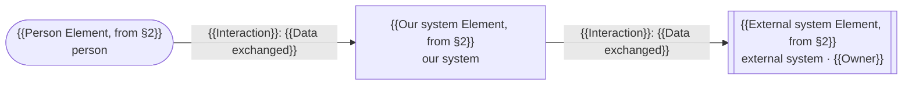
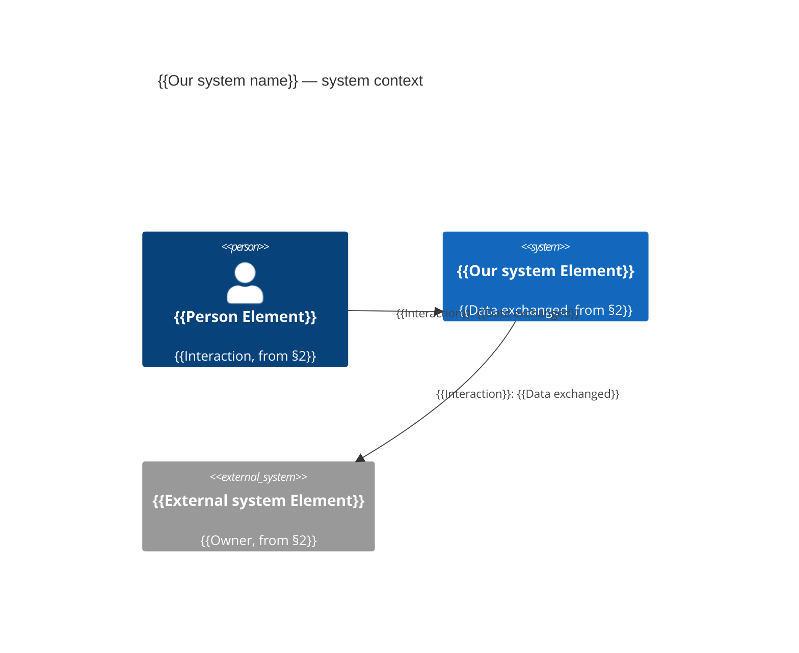
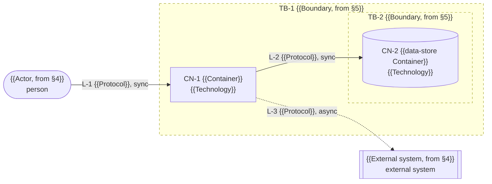
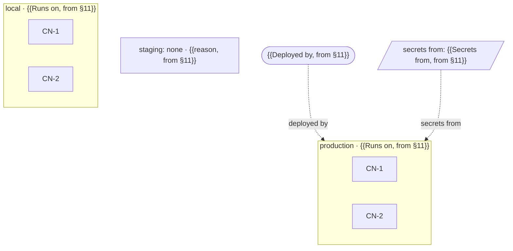
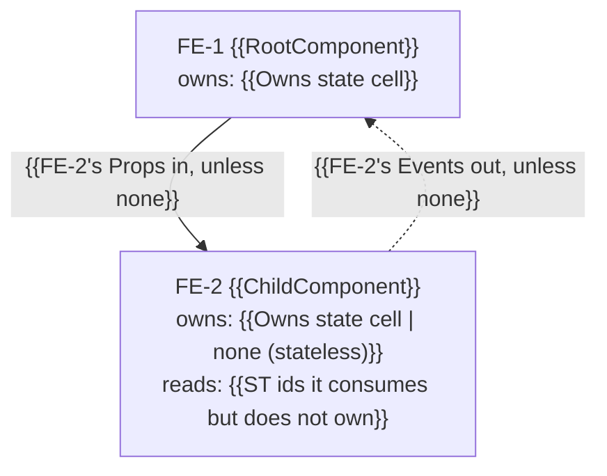
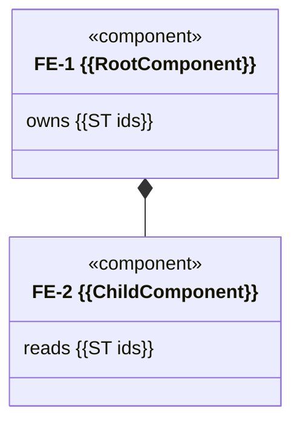

# draw-diagrams output skeleton

<!-- guide: draw-diagrams template. The output is ONE raw Mermaid file, `docs/architecture/diagrams/<type>.mmd`:
     Part A (header, every type) followed by exactly ONE body from Part B. No markdown fences in the .mmd file;
     the fences below only frame the skeletons. Replace every {{placeholder}}; keep the header lines in order.
     Every label, field, message and state comes verbatim from the source section (escapes: `"` → `#quot;`,
     `;` → `#59;`, `#` → `#35;`); a required thing the section does not state becomes a gap line, never an
     invention. Part C is written only when dispatched, at the job file's `## Return` path. Per-type notation:
     references/types.md; helpers (dd_*): references/kit.md. -->

## Part A — header block (every type; first lines of the file, in this order)

```text
%% diagram: {{type}}
%% source: {{doc path}}#{{section anchor}} @ {{short sha | short sha+dirty | uncommitted}}
%% drawn: {{contents of $tmp/drawn}} by draw-diagrams ({{harness: claude | codex}}, {{model id}})
%% render: {{verified | unverified}}
%% render-check: {{mmdc -> exit 0, SVG in temp dir | mmdc not on PATH | mmdc failed: <first error line>}}
%% missing: {{count of `%% ⚠ missing:` lines}}
%% Generated from the source section. Do not edit by hand: fix the section, then re-run `draw-diagrams {{type}}`.
```

- The `%% source:` lines are `$tmp/sources` verbatim: one per section read, in the order read (`hld-container`
  has three: §3, §4, §5).
- `%% render:` is exactly `verified` or `unverified`; the reason lives on `%% render-check:`. Until step 8 runs,
  write `unverified` and `not run yet`.
- `{{harness}}` is `claude` or `codex` in both modes (the tool running this skill), never "interactive".

### Gap line (every type)

```text
%% ⚠ missing: {{what is missing, e.g. "nullability of orders.customer_id"}} — {{doc path}}#{{section anchor}} does not state it
```

A contradiction is a gap too (the section states one thing two ways); draw the weaker of the two:

```text
%% ⚠ missing: one answer for {{what}} ({{first statement}} vs {{second statement}}) — {{doc path}}#{{section anchor}} states it both ways
```

Put each on its own line where the missing element would be drawn, indented like its neighbours.

## Part B — body (exactly one, matching the type)

### B1 `hld-context` (default: flowchart)



### B1-alt `hld-context` (only when the job or source asks for C4)



### B2 `hld-container`



### B3 `deployment`



Container nodes carry the CN id only (§11 names no containers, and §3 is not this job's source). Node ids are
`<env>_<CN id without hyphen>`, so the same container can appear in several environments. An environment the source
marks `none — <reason>` is one node (`staging_none` above), never an empty subgraph.

### B4 `erd`

```mermaid
erDiagram
    {{parent_table}} ||..o{ {{child_table}} : "{{fk_column}}"
    {{parent_table}} {
        {{type}} {{column}} PK "{{not null}} · {{rest of the Type cell, if any}}"
        {{type}} {{column}} UK "{{not null | nullable}} · {{unique constraint name}} ({{cols}})"
    }
    {{child_table}} {
        {{type}} {{column}} PK "not null"
        {{type}} {{fk_column}} FK "{{not null | nullable}} · ref {{parent_table}}.{{column}}"
    }
```

### B5 `be-class`

```mermaid
classDiagram
    class BE2["BE-2 {{ControllerName}}"]
    <<{{kind from the heading, e.g. controller}}>> BE2
    BE2 : +{{methodName}}({{params}}) {{ReturnType}}
    class BE1["BE-1 {{ServiceName}}"]
    <<{{kind from the heading, e.g. service}}>> BE1
    BE1 : +{{methodName}}({{params}}) {{ReturnType}}
    BE2 ..> BE1 : depends on
    note for BE2 "depends on: {{non-BE entries of Depends on, if any}}"
```

### B6 `fe-components` (default: flowchart)



### B6-alt `fe-components` (only when the job or source asks for a class view)



### B7 `sequence-<journey>`

```mermaid
sequenceDiagram
    autonumber
    actor {{Actor name, from Participants}}
    participant FE2 as FE-2 {{Name}}
    participant BE1 as BE-1 {{Name}}
    participant DB
    {{Actor name}}->>FE2: {{step 1 message}}
    FE2->>BE1: {{step 2 message}}
    alt main path (steps {{3-4}})
        BE1->>DB: {{step 3 message}}
        BE1-->>FE2: {{step 4 message}}
    else {{condition of the first alt replacing steps 3-4}}
        BE1->>DB: {{a1 message}}
        BE1-->>FE2: {{a2 message}}
    else {{condition of the second alt replacing steps 3-4}}
        BE1-->>FE2: {{a1 message}}
    end
```

One `else` per source `**alt**`, in source order. When the source names no error path at all, wrap every step in
`alt main path (steps 1-{{N}})` and end with exactly:

```text
    else ⚠ error path not in source
        Note over {{first participant}}: ⚠ missing: error path
        %% ⚠ missing: error path — {{doc path}}#{{section anchor}} does not state it
    end
```

### B8 `state-<entity>`

```mermaid
stateDiagram-v2
    state "{{state value that is not one word}}" as S1
    [*] --> {{initial}}
    {{initial}} --> S1 : {{Event cell}} [{{Guard cell}}]
    S1 --> {{terminal}} : {{Event cell}}
    {{terminal}} --> [*]
```

## Part C — result contract (dispatched only; at the job's `## Return` path)

```markdown
---
task: {{job or task id, e.g. M3-D01}}
harness: {{codex | claude}}
model: {{model id}}
status: {{done | human_review | relaunch}}
reason: {{one line, the first that applies: "commit blocked: <first error line>" | "source not committed" | "no unique section <ref> in <doc>" | "section is not in design-<hld|lld> form; run design-<hld|lld>" | "mmdc parse error after 2 fixes" | "<n> ⚠ missing in <doc>#<anchor>" | "no diagram placeholder in <doc>" | "rendered, no gaps" | "drawn, no gaps; render unverified"}}
base_sha: {{BASE}}
head_sha: {{short sha of your commit, or base_sha if not committed}}
changes: [docs/architecture/diagrams/{{type}}.mmd]
tests: "{{dd_trace -> no output; dd_done -> no output; dd_render -> verified | unverified: <reason>}}"
not_verified: [{{mermaid render, if unverified | none}}]
---

## Changes

- `docs/architecture/diagrams/{{type}}.mmd` — {{Mermaid kind}}; {{dd_counts output}}; {{k}} ⚠ missing;
  source {{each line of $tmp/sources without "%% source: "}}

## Tests run

    $ . {{tmp}}/kit.sh && dd_trace
    {{pasted output, or "(no output)"}}
    $ . {{tmp}}/kit.sh && dd_done
    {{pasted output, or "(no output)"}}
    $ . {{tmp}}/kit.sh && dd_render
    {{pasted output}}

## Questions

- ⚠ {{design-hld | design-lld}}: {{each gap phrased as a question the design owner answers, e.g. "Is orders.customer_id nullable?"}}
- {{each other applicable reason from the status order, e.g. "no <!-- diagram: erd --> placeholder in lld.md"}}
- {{or "none"}}
```

When no diagram was written (no unique section, not in design form), `changes: []` and `## Changes` says
"none — <reason>".
